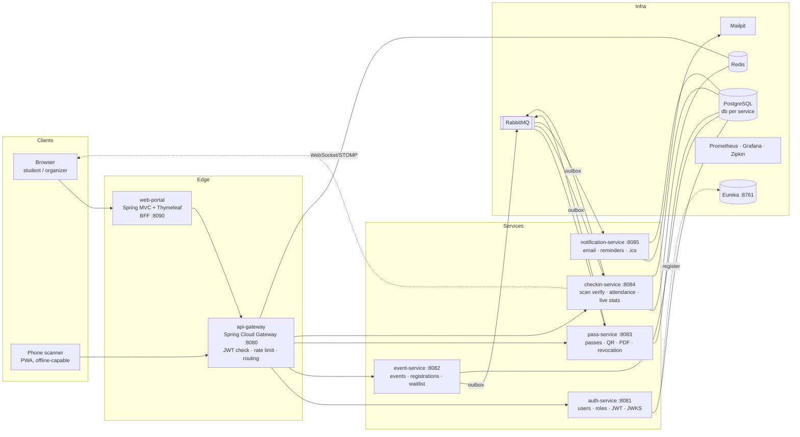
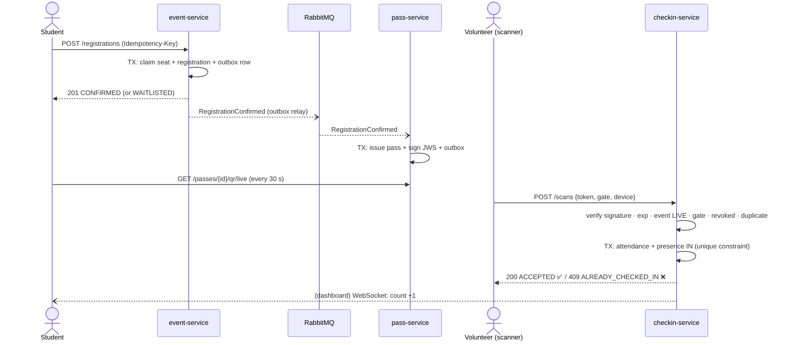
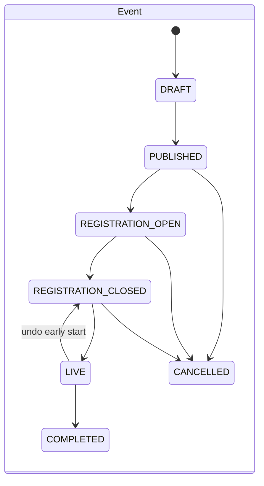

# 🎫 MITPass — College Event Pass System

> Register → Event → Generate Pass → QR Code → Scan → Verify → Mark Attendance

> **UI reference:** [MITPass App Screens.html](MITPass%20App%20Screens.html) is a clickable mockup of this flow. Use it as a rough guide, not a spec (see [§2 UI reference](#ui-reference)).

MITPass is a campus event platform. Students sign up for fests, workshops and seminars. Each confirmed registration gets a **cryptographically signed QR pass**. At the gate, volunteers scan it with a phone. The pass is verified in milliseconds, and attendance appears **live** on the organizer's dashboard.

It is a Web Programming (Java) semester project. Under the hood it is a set of **Spring Boot microservices** with an edge gateway, service discovery, event-driven messaging, and a server-rendered **Spring MVC** portal.

---

## 1. Goal

Build a working, demo-ready system that **clearly demonstrates every concept below**, where an evaluator can point at a screen and see each one:

| # | Concept | Where it is demonstrated |
|---|---------|--------------------------|
| 1 | **Spring MVC** | `web-portal`: controllers, Thymeleaf views, form binding and validation (`BindingResult`), Post/Redirect/Get, flash attributes, interceptors, error pages |
| 2 | **REST** | Every backend service: resource-oriented APIs, correct status codes, RFC 7807 `ProblemDetail` errors, pagination, `Idempotency-Key`, OpenAPI/Swagger UI |
| 3 | **JPA / Hibernate** | Entities and relationships, Flyway migrations, Spring Data repositories, Specifications for search, auditing, `@Version`, fetch-plan tuning (`@EntityGraph`) |
| 4 | **Authentication** | `auth-service`: BCrypt, RS256 JWT access tokens, rotating refresh tokens with reuse detection, JWKS endpoint, email verification |
| 5 | **Authorization** | Roles (STUDENT / ORGANIZER / VOLUNTEER / ADMIN), `@PreAuthorize`, ownership rules (an organizer edits only their own events), volunteer-to-event assignment checked at scan time |
| 6 | **QR generation** | `pass-service`: ZXing QR (PNG/SVG) with a logo overlay, a signed compact JWS payload, rotating "live" QR, PDF ticket |
| 7 | **QR verification** | `checkin-service`: a verification pipeline (signature → expiry → event → gate → revocation → duplicate), plus offline verification in the browser using WebCrypto |
| 8 | **Transactional DB operations** | Overbooking-proof seat claims, waitlist promotion inside one transaction, race-safe check-in, transactional outbox, idempotent consumers |
| 9 | **State management** | Explicit state machines for Event, Registration, Pass and Presence; illegal transitions return `409 Conflict`; transition history is audited |
| 10 | **Microservices architecture** | Database per service, API gateway, Eureka discovery, async events on RabbitMQ, choreographed saga (event cancellation), circuit breakers, distributed tracing |

**Definition of done:** with one `docker compose up`, a presenter can:

1. register as a student,
2. get a pass by email and in the wallet,
3. scan it with a phone at the "gate",
4. watch the live dashboard tick up,
5. try a screenshot, a revoked pass and a double scan, and see each one rejected,
6. pull the Wi-Fi and keep scanning offline,
7. open Grafana and Zipkin to show the request flow across services.

### Non-goals

Payments, native mobile apps, and multi-college tenancy. These are listed as possible extensions only.

---

## 2. Features

**Students:** browse and search events (by category, date and department), register or cancel, see their waitlist position, keep a "My Passes" wallet with a rotating QR, download a PDF ticket, add events to their calendar (`.ics`), and view attendance history and certificate eligibility.

**Organizers:** create and edit events (venue, capacity, registration window, eligibility rules, sessions), move an event through its lifecycle, see registrations, revoke passes, assign volunteers to gates, view a live attendance dashboard, and export attendance as CSV. **Every organizer is also a volunteer** (owner decision, 2026-10-16): they check people in and out at any gate of the events they organize without being assigned; at other events the volunteer rules apply to them.

**Volunteers:** scan only at gates they are assigned to (they may scan their own ticket there; they can't revoke passes or undo a check-in). A full-screen camera scanner with a big green/red result, sound and vibration, a gate selector, manual pass-number entry, check-in/check-out mode, and offline mode with later sync.

**Admins:** user and role management, and a system health overview.

### Anti-fraud features

- QR payloads are **signed with ES256**. A forged or edited QR fails signature verification.
- The **rotating QR** is a short-lived token (about 45 s) refreshed every 30 s on the student's phone, so screenshots stop working.
- There is **one check-in per pass per session**, enforced by a database unique constraint, not only by application code.
- **Revocation lists** are synced to scanners, so revoked passes are rejected even when scanning offline.
- Pass numbers carry a **Luhn check digit**, so typos in manual entry are caught right away.

### UI reference

[`MITPass App Screens.html`](MITPass%20App%20Screens.html) in the repo root is a mockup of the main flow, with seven screens in order. Open it in a browser (it is a self-contained export and needs JavaScript). The owner updates the file when the design changes, so open the current copy before UI work instead of relying on an older description of it.

| # | Screen | Who uses it | Backed by | Thin page in | Finished in |
|---|--------|-------------|-----------|--------------|-------------|
| 1 | Register (sign-up) | Student | `auth-service` (P2) | P3 | P6 |
| 2 | Event detail | Student | `event-service` (P1, P3) | P3 | P6 |
| 3 | Pass issued | Student | `event-service` + `pass-service` (P3, P4) | P4 | P6 |
| 4 | QR code (wallet) | Student | `pass-service` (P4) | P4 | P6 |
| 5 | Scan | Volunteer | `checkin-service` (P5) | P5 (manual entry) | P6 (camera) |
| 6 | Verify (result) | Volunteer | `checkin-service` (P5) | P5 | P6 |
| 7 | Mark attendance (dashboard) | Organizer | `checkin-service` (P5) | P5 (static counts) | P6, live updates in P7 |

A "thin page" is a plain Thymeleaf page added in the same phase as its backend, just enough to see that phase working in a browser (see [§5](#5-roadmap-8-phases)).

How to use it:

- **Follow it for the flow and the feel:** the order of screens, what each screen shows, and the visual direction (maroon "passport cover" header, blue-grey background, condensed display font for headings, monospace for pass numbers, green/amber/red gate results).
- **Don't treat it as a pixel spec.** Change layout, spacing or wording wherever that makes the build simpler or the screen clearer. Record notable deviations in `log.md`.
- **This document wins on behaviour and data.** If the mockup shows something this plan doesn't support, or the reverse, follow this plan, or update both if the change is worth it.
- **Don't copy its markup.** It is a bundled export of a design canvas, not reusable HTML. Rebuild the screens in `web-portal` with Thymeleaf + hand-written CSS (design tokens taken from the mockup; owner decision, 2026-10-17, D15).
- **Placeholders are placeholders.** Names, pass numbers, counts and times in it are sample data.
- **Screens it doesn't cover** (organizer event form, volunteer assignment, admin, stamps/attendance history, error pages) follow the same visual language.

---

## 3. Architecture



### Services and data ownership

| Service | Owns (its own database) | Publishes | Consumes |
|---|---|---|---|
| `auth-service` | users, roles, refresh tokens, verification tokens | `UserRegistered` | — |
| `event-service` | venues, events, sessions, registrations, waitlist, state history | `RegistrationConfirmed`, `RegistrationWaitlisted` (P7), `RegistrationCancelled`, `WaitlistPromoted`, `EventStateChanged`, `EventRescheduled` | — |
| `pass-service` | passes, signing keys, revocations | `PassIssued`, `PassRevoked` | `RegistrationConfirmed`, `RegistrationCancelled`, `EventStateChanged`, `EventRescheduled`, `AttendanceMarked` |
| `checkin-service` | scan log, attendance, presence, device sync batches (plus a read-only copy of passes and event status for scanning) | `AttendanceMarked` | `PassIssued`, `PassRevoked`, `EventStateChanged` |
| `notification-service` | notification log, reminder schedule | — | all of the above (recipients for bulk mails are read from event-service at send time, so it keeps no copy; owner, 2026-10-20) |
| `web-portal` | HTTP sessions only (BFF; tokens never reach the browser) | — | — |

There are no cross-service database joins. Services work together through **REST** (synchronous, for queries) and **RabbitMQ** (asynchronous, for facts that already happened).

**Source of truth.** Each fact has exactly one owner: the service in whose "Owns" column it appears. A copy of another service's data (for example pass-service's event times, or checkin-service's pass copy) is a read-only cache. It is filled from the owner's events and can be rebuilt from the owner at any time. When a copy and its owner disagree, the owner is right. Details: `docs/DECISIONS.md` D14.

### The core flow



### State machines



| Aggregate | States | Notes |
|---|---|---|
| **Event** | DRAFT → PUBLISHED → REGISTRATION_OPEN → REGISTRATION_CLOSED → LIVE → COMPLETED; CANCELLED from any pre-LIVE state; LIVE → REGISTRATION_CLOSED (undo an accidental early start) | Time-based transitions happen through `@Scheduled`. **LIVE is entered only by the scheduler** (owner decision, 2026-10-15); organizers can open/close registration early, complete, cancel, and undo LIVE. Each transition is written to `event_state_history`. |
| **Registration** | PENDING → CONFIRMED / WAITLISTED → CANCELLED; WAITLISTED → CONFIRMED (promotion) | Promotion happens in the same transaction as the cancellation that freed the seat. One *active* registration per student per event; after cancelling, a student may register again (new row). |
| **Pass** | ISSUED → ACTIVE → EXPIRED; ISSUED → EXPIRED; ISSUED/ACTIVE → REVOKED | Owned by `pass-service` (is the pass *valid*?). **ACTIVE means the live code is unlocked**: 2 h before doors open (configurable), as in the UI mockup's wallet (owner decision, 2026-10-16). Before that only the static QR / PDF exists, if the event allows it. ISSUED → EXPIRED covers a pass whose event ended before it unlocked. |
| **Presence** | NOT_ARRIVED → IN ⇄ OUT | Owned by `checkin-service` (where is the attendee?). Re-entry is allowed only if the event allows it. |

All transitions go through one `transition(from, to)` method backed by an enum transition table. An illegal move returns `409` with a `ProblemDetail` that lists the allowed next states.

---

## 4. Tech Stack

| Layer | Choice | Why |
|---|---|---|
| Language | **Java 21 (LTS)** | Records, sealed types, pattern matching, virtual threads |
| Framework | **Spring Boot 4.1** (Spring Framework 7, Jakarta EE 11, Jackson 3, Hibernate 7) + **Spring Cloud 2025.1 (Oakwood)** | A supported pair, pinned in the root `pom.xml` (exact versions and reasons: `docs/DECISIONS.md` D1) |
| Build | Maven multi-module through the committed wrapper (`./mvnw`, Maven 3.9); a project-local JDK in `.tools/jdk-21` | One parent POM for all services; nothing installed globally (`scripts/setup-jdk.ps1`) |
| Web (server-rendered) | **Spring MVC + Thymeleaf + HTMX**, hand-written CSS with design tokens; JS libraries as WebJars | Shows classic MVC; HTMX gives an SPA feel without a JS framework. No Node build step (owner decision, 2026-10-17: Tailwind dropped as more setup than it saves for a portal this size; D15) |
| REST | Spring Web, Bean Validation, `ProblemDetail`, **springdoc-openapi** | Swagger UI combined at the gateway |
| Persistence | **Spring Data JPA / Hibernate**, **PostgreSQL 16**, **Flyway** | Database per service; migrations under version control |
| Mapping | MapStruct | Keeps entities out of API responses |
| Security | **Spring Security**, OAuth2 Resource Server, Nimbus JOSE (RS256 / ES256) | Asymmetric keys mean services verify tokens without a shared secret |
| Gateway / discovery | **Spring Cloud Gateway**, **Netflix Eureka** | Edge routing, JWT pre-check, rate limiting |
| Messaging | **RabbitMQ** (Spring AMQP) + transactional outbox | Reliable domain events, dead-letter queues |
| Cache / counters | **Redis** | Gateway rate limiting, live attendance counters |
| QR | **ZXing** | Generate PNG/SVG |
| Scanner (browser) | `html5-qrcode`, Service Worker (PWA), IndexedDB, WebCrypto | Camera scanning, offline verification |
| Real-time | Spring WebSocket + **STOMP**, Chart.js | Live dashboard |
| Documents | OpenPDF (PDF ticket), iCal4j (`.ics`) | Downloadable ticket and calendar invite |
| Email | Spring Mail + Thymeleaf templates → **Mailpit** (local SMTP inbox) | Shows real emails without sending any |
| Resilience | **Resilience4j** | Circuit breaker, retry, timeouts |
| Observability | Micrometer → **Prometheus + Grafana**, Micrometer Tracing → **Zipkin** | Dashboards and request traces across services |
| Testing | JUnit Jupiter 6, Mockito, `@WebMvcTest`/`@DataJpaTest`, **Testcontainers 2**, **Gatling** (Java DSL) | Unit, slice, integration and load tests |
| Ops | Docker Compose, `spring-boot:build-image`, GitHub Actions CI | One-command startup |

### Repository layout (target)

```
mitpass/
├── pom.xml                      # parent: versions, plugins, modules
├── mvnw, mvnw.cmd, .mvn/        # Maven wrapper (falls back to .tools/jdk-21 when JAVA_HOME is unset)
├── scripts/                     # setup-jdk.ps1, env.ps1 / env.sh
├── .tools/                      # project-local JDK (gitignored, created by scripts/setup-jdk.ps1)
├── libs/
│   ├── common-web/              # ProblemDetail handler, pagination, correlation IDs
│   ├── common-security/         # resource-server config, role constants, JWKS client
│   └── common-messaging/        # outbox entity + relay, event envelopes, idempotent consumer
├── platform/
│   ├── discovery-server/
│   └── api-gateway/
├── services/
│   ├── auth-service/
│   ├── event-service/
│   ├── pass-service/
│   ├── checkin-service/
│   └── notification-service/
├── web-portal/
├── load-tests/                  # Gatling simulations
├── infra/
│   ├── docker-compose.yml
│   ├── postgres/init.sql        # one database per service
│   ├── prometheus/ grafana/     # provisioned dashboards
│   └── certs/                   # self-signed dev cert from scripts/make-dev-cert (phone camera needs HTTPS; gitignored)
└── docs/                        # API.md, DEMO_SCRIPT.md, DECISIONS.md, plans/ (one plan per phase)
```

---

## 5. Roadmap: 8 phases

Each phase is about the same size: one main backend capability plus its tests, and a **demo checkpoint** that can be shown on its own. Every phase leaves the system runnable. Task IDs in `log.md` are T03–T10 (one per phase).

**Portal slices (P3–P5).** The backend phases each add a thin `web-portal` slice so their effects can be seen in a browser, not only in Swagger. A slice is plain Thymeleaf with minimal styling. It has no HTMX, camera, dark mode or polish. It still keeps tokens in the server-side session (the BFF rule in §3). P6 turns these slices into the full portal. The reasons, the rules every slice keeps, and each shortcut with its P6 replacement are in `docs/DECISIONS.md` D9. Shortcuts listed there are intended, not bugs.

```
P1 Foundation ─► P2 Auth ─► P3 Registration/TX ─► P4 Pass+QR ─► P5 Scan+Verify ─► P6 MVC Portal ─► P7 Realtime+Offline ─► P8 Hardening+Showcase
```

---

### P1 — Foundation & Event Catalogue

**Goal:** a running microservice skeleton with one real service behind a gateway.

- [x] Maven multi-module parent; pin Java 21 and a compatible Spring Boot + Spring Cloud pair; Spotless/Checkstyle.
- [x] `infra/docker-compose.yml`: PostgreSQL (init script creates one database per service), RabbitMQ, Mailpit.
- [x] `discovery-server` (Eureka) and `api-gateway` with route `/api/events/** → lb://event-service`.
- [x] `libs/common-web`: global `@RestControllerAdvice` → RFC 7807 `ProblemDetail`, validation error mapping, page DTO, correlation-ID filter.
- [x] `event-service`: entities `Venue`, `Category`, `Event`, `EventSession` (one-to-many, with an explicit fetch strategy); JPA auditing (`createdAt/By`); Flyway `V1__init.sql`.
- [x] REST CRUD plus search (`/events?category=&from=&to=&q=&page=`) using JPA Specifications; MapStruct DTOs; Bean Validation.
- [x] springdoc OpenAPI; Swagger UI available through the gateway.
- [x] Tests: `@DataJpaTest` (repositories, specifications), `@WebMvcTest` (validation → 400 `ProblemDetail`).
- [x] GitHub Actions: build and test on push (green since `baa98cd`).

**Concepts:** REST, JPA/Hibernate, microservice skeleton (gateway + discovery).
**Exit criteria / demo:** `docker compose up` plus the services start cleanly; the Eureka dashboard shows the services; events can be created and searched through `http://localhost:8080` in Swagger; an invalid payload returns a structured 400.
**Status:** done 2026-10-10. Exit demo verified live; as-built notes in `docs/plans/phase-1.md` §14, run steps in `README.md`.

---

### P2 — Identity, Authentication & Authorization

**Goal:** every write is authenticated and every action is authorized (catalogue reads stay public, so events can be browsed before sign-up). Plan: `docs/plans/phase-2.md`.

- [x] `auth-service`: `User`, `Role` (many-to-many); sign-up limited to college addresses (`<register number>@student.annauniv.edu`) and Gmail; BCrypt; email verification token (sent to Mailpit).
- [x] Login → **RS256 JWT** access token (15 min) with `sub`, `roles`, `dept`, `year` claims; `/.well-known/jwks.json` with `kid` for key rotation.
- [x] Refresh tokens: random, stored **hashed**, rotated on every use; reusing an old token revokes the whole token family (theft detection).
- [x] `libs/common-security`: shared OAuth2 resource-server config that validates JWTs through JWKS, with no shared secret.
- [x] Gateway: rejects missing or expired tokens at the edge, forwards claims, configures CORS.
- [x] Authorization: `@PreAuthorize` per endpoint; a custom `@eventSecurity.isOwner(#id)` bean so an organizer can edit only their own events; admin can promote users; organizer assigns volunteers to an event and gate.
- [x] Logout and token revocation (stateless: the refresh-token family is revoked, an issued access token expires within 15 min); account lockout after N failed logins.
- [x] Tests: a security matrix test that runs every role against every protected endpoint and expects 200/401/403.

**Concepts:** authentication, authorization, stateless security across services.
**Exit criteria / demo:** a printed role × endpoint matrix, all green; a forged token (edited payload) is rejected by every service; refresh-token reuse kills the session.
**Status:** done 2026-10-11. Live exit demo 36/36 checks; security matrix 205/205 cells ([docs/security-matrix.md](docs/security-matrix.md)); 158 tests green. As-built notes in `docs/plans/phase-2.md` §16, decisions in `docs/DECISIONS.md` D7/D8, demo requests in `docs/http/phase-2.http`.

---

### P3 — Registration & Transactional Core

**Goal:** registrations that cannot overbook, with correct lifecycle state, under heavy concurrency. Plan: `docs/plans/phase-3.md`.

- [x] Event state machine (enum transition table, `transition()` guard, `event_state_history`); `@Scheduled` job opens and closes registration, starts the event (LIVE, scheduler only) and completes it at configured times; organizers can undo an early LIVE; illegal transition → 409.
- [x] `Registration` aggregate (PENDING → CONFIRMED / WAITLISTED → CANCELLED); one active registration per `(event_id, user_id)` (partial unique index), so re-registering after a cancellation creates a new row.
- [x] Seat claim inside one `@Transactional` method: a conditional update (`UPDATE … SET seats_taken = seats_taken + 1 WHERE seats_taken < capacity`) or `PESSIMISTIC_WRITE`; `@Version` optimistic locking for organizer edits (a concurrent edit → 409 with a "reload" hint).
- [x] Waitlist: FIFO position; a cancellation promotes the next waitlisted student **in the same transaction**.
- [x] Eligibility rules: department/year restrictions and the registration window, checked in the domain layer.
- [x] `Idempotency-Key` header: stored with the response, so a retry returns the original result instead of creating a duplicate.
- [x] `libs/common-messaging`: **transactional outbox** (the business row and outbox row commit together) plus a relay that publishes to RabbitMQ. auth-service publishes `UserRegistered` through it.
- [x] **Concurrency test:** 500 parallel registrations for 100 seats → exactly 100 CONFIRMED, 400 WAITLISTED, `seats_taken == 100`. Also show the failing naive version for contrast.
- [x] **Portal slice** (rules and intended shortcuts: `docs/DECISIONS.md` D9): create `web-portal` (:8090, Spring MVC + Thymeleaf) with sign-up and login against `auth-service` (tokens in the server-side session; the user logs in again when the access token expires, automatic refresh comes in P6). Pages: event catalogue and event detail with seats left; register/cancel showing CONFIRMED, or WAITLISTED with the position; an organizer "My events" list with buttons for the allowed lifecycle transitions only.

**Concepts:** transactional DB operations, locking strategies, state management, reliable messaging.
**Exit criteria / demo:** the concurrency test runs live and the numbers are exact; a cancellation promotes waitlist #1 and the outbox row shows up in the RabbitMQ management UI. In the portal: sign up, register for an event, cancel, and see a waitlisted student's status change to CONFIRMED.
**Status:** done 2026-10-16. Live exit demo 56 checks (two failures on the first run led to two fixes, both verified); concurrency test exact in three runs; security matrix 253/253 cells. As-built notes in `docs/plans/phase-3.md` §18, decisions in `docs/DECISIONS.md` D10/D11, demo requests in `docs/http/phase-3.http`.

---

### P4 — Pass Issuance & QR Generation

**Goal:** a confirmed registration automatically becomes a signed, scannable pass. Plan: `docs/plans/phase-4.md`.

- [x] `pass-service` consumes `RegistrationConfirmed` as an **idempotent consumer** (`processed_message` table, in the same transaction as the pass; one pass per registration is also a unique constraint), so a redelivered message never issues two passes.
- [x] Pass state machine (ISSUED → ACTIVE → EXPIRED / REVOKED; ACTIVE = the live code unlocks 2 h before doors open); human-readable pass number `TECHFEST26-000042-7` (Luhn check digit: catches every digit typo and about 9 in 10 letter typos, see D12).
- [x] **Minimal dead-letter queue** for pass-service's inbox (3 retries, then `pass-service.inbox.dlq`), with the helper in `libs/common-messaging` (owner decision, 2026-10-16). **Pulled forward from P7 and completed there** (see §P7).
- [x] event-service publishes `EventRescheduled` when an event's start or end time changes, so pass unlock and expiry times follow (owner decision, 2026-10-16). Per-event `staticQrAllowed` and `passColor` live in event-service.
- [x] QR payload = compact **JWS (ES256)** `{pid, eid, sub, sid?, iat, exp, jti}` plus `iss` and `knd` (live/static), with `kid` and `typ: mitpass-pass+jws`; separate signing keys from auth; pass-service publishes its own JWKS for scanners.
- [x] **ZXing** QR rendering: PNG and SVG endpoints, error-correction level M, centered college logo, colors themed per event (a colour too light to scan reliably falls back to near-black). *Level H until 2026-10-19: with a 467-character token it made a 113×113-module code that phone cameras couldn't read off a screen in the two-phone demo; M gives 85×85 (owner decision, D12).*
- [x] **Rotating QR:** `GET /passes/{id}/qr/live` returns a token valid for about 45 s; the static PDF/email QR uses a longer-lived token if the event allows it.
- [x] **PDF ticket** (OpenPDF): event banner, attendee name and photo initials, QR, pass number, venue map link.
- [x] Revocation: an organizer revokes a pass (→ `PassRevoked`); `GET /revocations?since=` gives scanners a delta feed.
- [x] Saga step: `EventStateChanged(CANCELLED)` → revoke all passes for that event.
- [x] Tests: JWS sign/verify round trip, a tampered payload fails, consumer idempotency (deliver the same message twice).
- [x] **Portal slice** (rules and intended shortcuts: `docs/DECISIONS.md` D9): a "My Passes" page listing each pass with its number and state; a pass page (QR, or when the code unlocks) whose live QR image reloads every 30 s; a PDF download link; an organizer registrations list with a revoke button.

**Concepts:** QR generation, digital signatures, event-driven microservices, state management.
**Exit criteria / demo:** register → the pass exists within about 1 s; decode the QR with any phone app → a JWS that verifies against the public JWKS; edit one character → verification fails. In the portal: register → the pass appears in "My Passes" → the organizer revokes it → it shows REVOKED.
**Status:** done 2026-10-16. Live exit demo 47/47 checks on the first run (pass in 0.8 s; the decoded QR verified by `scripts/VerifyPassToken.java` with the JDK only; republished message → still one pass; saga; key rotation; portal journey); security matrix 330/330 cells; 378 tests green. As-built notes in `docs/plans/phase-4.md` §20, decisions in `docs/DECISIONS.md` D12/D13, demo requests in `docs/http/phase-4.http`.

---

### P5 — Scan, Verify & Attendance

**Goal:** an authoritative, race-safe check-in API that covers every realistic gate scenario. Plan: `docs/plans/phase-5.md`.

- [x] `checkin-service` `POST /scans {token, gateId, deviceId, scannedAt}`, allowed for the VOLUNTEER role only.
- [x] **Verification pipeline** (chain of responsibility, each step a bean): volunteer is assigned to this event and gate (checked first, so an unassigned account learns nothing about the pass; owner decision, 2026-10-16) → decode → signature (cached JWKS by `kid`) → `exp` with clock-skew tolerance → pass is for this event → event is LIVE → session open → pass known → not revoked → duplicate check.
- [x] Typed result codes: `ACCEPTED`, `ALREADY_CHECKED_IN`, `REVOKED`, `EXPIRED_TOKEN`, `WRONG_EVENT`, `WRONG_GATE`, `NOT_YET_OPEN`, `INVALID_SIGNATURE`, `UNAUTHORIZED_SCANNER`, plus `CHECKED_OUT`, `NOT_CHECKED_IN`, `REENTRY_NOT_ALLOWED`, `EVENT_CLOSED`, `UNKNOWN_PASS`, `INVALID_PASS_NUMBER` for cases the first nine can't express (owner decision, 2026-10-16; `docs/plans/phase-5.md` §5). Each code comes with a user-facing message and a color.
- [x] checkin-service keeps a read-only copy of passes (from `PassIssued` / `PassRevoked`) so a scan never calls pass-service; pass-service stays the source of truth (D14). The copy is reconciled automatically (owner decision, 2026-10-16): revocation feed every minute, passes of events in the scanning window every 5 min, an unknown but genuine pass fetched during the scan, using a new internal **service identity** (`SERVICE` tokens from auth-service, D7). Re-entry (`reentryAllowed`) and the certificate threshold (`certificateMinSessions`) are per-event settings in event-service (owner decisions, 2026-10-16).
- [x] Check-in transaction: `Attendance` + `ScanLog` + presence update; **unique `(pass_id, session_id)`** plus a row lock. Two volunteers scanning the same pass in the same millisecond → exactly one `ACCEPTED`.
- [x] Check-out / re-entry mode (presence IN ⇄ OUT); per-session attendance for multi-session workshops.
- [x] Manual fallback: look up by pass number (Luhn validated) and confirm visually with the name.
- [x] pass-service's own event copy is reconciled the same way (REVIEW-LATER RL7, owner 2026-10-16): every 5 min it re-reads status and times of events with valid passes, so a lost cancellation still revokes the passes.
- [x] `AttendanceMarked` via the outbox; pass-service listens and marks single-entry passes as used (new pass fields `checkedInAt` / `usedAt`, no new pass state; owner decision, 2026-10-16).
- [x] Reports: per-event attendance %, CSV export, certificate eligibility (attended ≥ N sessions).
- [x] Tests: one test per result code, plus a double-scan race test.
- [x] **Portal slice** (rules and intended shortcuts: `docs/DECISIONS.md` D9): a volunteer scan page with a gate selector and a text field for a pass number or pasted QR token (no camera yet), and a result page showing the result code, message and color; an organizer attendance page with counts and the attendee list (reload to update) and the CSV export link.

**Concepts:** QR verification, authorization at the domain level, transactional DB operations, state management.
**Exit criteria / demo:** a `.http` / Postman collection runs every scenario and gets the expected code; the race test shows 1 accepted and N−1 `ALREADY_CHECKED_IN`. In the portal: enter a pass number → green ACCEPTED; enter it again → ALREADY_CHECKED_IN; the attendance page shows the new count.
**Status:** done 2026-10-16. Live exit demo on compose infra (every result code through the gateway, portal scan/confirm/attendance, CSV; scripted checks in the session scratchpad, same steps in `docs/http/phase-5.http`). The owner's "no manual steps" rule was shown live three times: a pass issued before checkin-service's queue existed was pulled in by the scheduled sync before any scan; a revocation whose message was purged was caught by the revocation feed after a restart; and (RL7, pass-service) an event cancellation whose message was purged still revoked the pass. Race test: 20 simultaneous scans → 1 ACCEPTED, 19 ALREADY_CHECKED_IN, three runs. Security matrix 410/410 cells; 470 tests green. As-built notes in `docs/plans/phase-5.md` §21, decisions in `docs/DECISIONS.md` D7/D14, demo requests in `docs/http/phase-5.http`.

---

### P6 — Web Portal (Spring MVC)

**Goal:** turn the thin slices from P3–P5 into a polished, server-rendered UI for all four roles, built with Spring MVC. Plan: `docs/plans/phase-6.md`.

- [x] Restyle and complete the slice pages from the [UI reference](#ui-reference) (screens 1–7) for flow and look. It's a guide, not a spec; adapt it where Thymeleaf/HTMX makes something simpler. Styling is hand-written CSS with design tokens (owner decision, 2026-10-17; D15).
- [x] Replace every slice shortcut in `docs/DECISIONS.md` D9. P6 isn't done while any of them is left.
- [x] `web-portal` as a **BFF**: form login against `auth-service`; tokens are kept in the server-side session and never reach the browser; RestClient calls through the gateway with automatic token refresh.
- [x] MVC fundamentals done properly: `@Controller` + `Model`, `@ModelAttribute` form objects, `BindingResult` errors shown inline, **Post/Redirect/Get**, flash messages, CSRF, a `HandlerInterceptor` for the current user, custom 403/404/500 pages, i18n message bundles in **English and Tamil** with a language switch (owner decision, 2026-10-17).
- [x] Student: event catalogue with HTMX live search and filters, event detail, register/cancel, waitlist position; **"My Passes" wallet** with glassmorphism pass cards, a rotating QR with a countdown ring, PDF download.
- [x] Organizer: event create/edit form (sessions as a dynamic sub-form), lifecycle buttons that show only the allowed transitions, registrations table, revoke pass, volunteer assignment. A **DRAFT** event is visible only to its own organizer and admins; for everyone else it is a 404, in the catalogue, on its page and its sessions (owner decision, 2026-10-17: found while building the catalogue, where drafts were public).
- [x] Volunteer: **full-screen camera scanner** (`html5-qrcode`) with a gate selector, a large green/red flash, sound and vibration, the attendee's name on success, and a manual-entry tab.
- [x] Admin: user and role management, and a system health overview (each service's status from its actuator health endpoint, collected by the gateway's ADMIN-only `GET /api/admin/health` from the Eureka registry, so the portal still calls only the gateway; owner decision, 2026-10-17).
- [x] Dark mode, responsive (the scanner is phone-first); a self-signed HTTPS dev cert made with the project JDK's `keytool` (portal `lan` profile on :8443) so phone cameras work over the LAN. No mkcert: it would change the system trust store (owner decision, 2026-10-17).

**Concepts:** Spring MVC (the main showcase), authentication and session handling, authorization in views (`sec:authorize`).
**Exit criteria / demo:** the full journey works in a browser: sign up → register → open the pass on a phone → scan it with a second phone → green flash.
**Status:** done 2026-10-19. Two-phone exit demo by the owner: phone B's camera scanned phone A's live pass over the laptop's hotspot (getting there: `archive/2026-10-19_phone-demo_network-diagnosis.md`; QR level H → M and scanner fixes, D12). Tamil reviewed by the owner. Built 2026-10-18; Checked in a real browser (Playwright, Edge; AGENTS.md): sign-up → the Mailpit link opens the portal → log in; the student journey to a live pass card; the scanner reading a real live QR through a fake camera (green, then amber); organizer, admin, Tamil and a dark-mode/360 px/accessibility sweep over every role's pages; the `lan` profile over HTTPS (secure context, `Secure` cookie). With 1-minute access tokens a user worked for 5 minutes without being sent to log in (6 rotations, none reused) (a bug found there was fixed: the refresh window is now at most a quarter of the token's lifetime). Health overview: stopping pass-service showed it DOWN on the next refresh. Every D9 shortcut is replaced (D9 table). 593 tests green (2026-10-19). As-built notes in `docs/plans/phase-6.md` §18, decisions in `docs/DECISIONS.md` D15, demo requests in `docs/http/phase-6.http`.

---

### P7 — Real-time Dashboard, Notifications & Offline Scanning

**Goal:** the visible "wow" layer on top of the core flow. Plan: `docs/plans/phase-7.md` (owner decisions 2026-10-20: plan §2, §17; `docs/DECISIONS.md` D16).

- [x] **Live attendance dashboard** (UI reference screen 7): checkin-service pushes over **WebSocket/STOMP** (`/topic/events/{id}`): an animated live counter, arrivals per 5 minutes (Chart.js), per-gate throughput, a recent-scans ticker (first names only), capacity gauge. Counters live in Redis (a cache rebuilt from PostgreSQL; a Redis failure never fails a scan). **The portal relays** the feed to the browser over its own STOMP endpoint, so no token reaches the browser (owner, 2026-10-20). Organizer and admin only; volunteers see their own gate's count on the scanner.
- [x] `notification-service`: consumes the domain events → HTML emails (Thymeleaf templates, English) to Mailpit: pass issued (inline QR + `.ics`), waitlisted (new `RegistrationWaitlisted` event), promoted, registration cancelled, event cancelled and rescheduled (updated `.ics`); sent in the listener with retry, then a **dead-letter queue** (owner, 2026-10-20). An "Add to calendar" `.ics` for the portal comes from the same service.
- [x] **Complete the dead-letter handling started in P4** (P4 built only a minimal DLQ for pass-service): DLQs for every consumer (notification-service, checkin-service), a way to inspect and replay dead-lettered messages (ADMIN endpoints + an Admin · Dead letters portal page), and a health/metric signal when a DLQ isn't empty (WARNING on the health overview).
- [x] Reminders 24 h and 1 h before the event through `@Scheduled`, with **ShedLock** so running several instances never sends duplicates.
- [x] **Offline scanner (PWA):** a service worker caches the app shell; the scanner prefetches the pass JWKS, the revocation list and the attendee manifest for its event.
  - [x] Verifies the ES256 JWS **in the browser using WebCrypto**, checks `exp` and revocations locally. Check-in only while offline; check-out needs the network (owner, 2026-10-20).
  - [x] Queues scans in IndexedDB and shows a badge such as "OFFLINE · 12 queued".
  - [x] `POST /scans/batch` on reconnect; server-side conflict resolution: **the first check-in recorded wins** (a batch is applied in `scannedAt` order; an existing check-in is never rewritten); later ones are recorded as `DUPLICATE_OFFLINE` and shown to the volunteer. A queued scan older than 12 h or more than 2 min in the future is refused (`REJECTED_OFFLINE_CLOCK`) (owner, 2026-10-20).

**Concepts:** microservices (async choreography), state management across devices, QR verification at the edge.
**Exit criteria / demo:** project the dashboard while scanning (the counter ticks up live); an email arrives in Mailpit with the QR; Wi-Fi off → scanning continues → Wi-Fi on → the queue syncs and conflicts are flagged.
**Status:** done 2026-10-21 (the two-phone run is parked for after P8: `docs/REVIEW-LATER.md` RL14, owner). On the running stack, `web-portal/ui-checks/p7.mjs` passes every check (the dashboard moves ~1.1 s after a scan; the pass email has the QR inline and the `.ics`; WebCrypto verifies a real live code; offline scans queue and sync, a pass checked in meanwhile comes back `DUPLICATE_OFFLINE`; the service worker serves the scanner offline; a poison message → DLQ → amber health → discarded), and `reminders.mjs` gets each 1 h reminder once with two notification-service instances. Four bugs found live were fixed (the gateway's WebSocket origin, a reconnect storm, the worker's empty cache, a 360 px overflow). Security matrix 509/509 cells; 654 tests green. As-built notes in `docs/plans/phase-7.md` §18, decisions in `docs/DECISIONS.md` D13/D16, demo requests in `docs/http/phase-7.http`.

---

### P8 — Hardening, Observability & Showcase

**Goal:** make it robust, measurable and presentable.

- [ ] **Observability:** Micrometer → Prometheus; provisioned Grafana dashboards (requests/s, p95 latency, scans/min, registration rate, outbox lag); **Zipkin traces** that follow one scan through gateway → checkin → pass; JSON logs with trace and correlation IDs.
- [ ] **Resilience:** Resilience4j circuit breakers, retries and timeouts on service-to-service calls (for example, the scan falls back to the cached revocation list if pass-service is down); gateway rate limiting on `/login` and `/scans` backed by Redis.
- [ ] **Testing:** Testcontainers integration tests (PostgreSQL, RabbitMQ) for each service; one cross-service end-to-end test (register → pass → scan → attendance).
- [ ] **Load test:** a Gatling (Java DSL) simulation of "1,000 students arriving in 10 minutes across 4 gates", with an HTML report kept in `docs/`.
- [ ] **Ops:** container images through `spring-boot:build-image`; the full stack (services included) with one `docker compose up`; health and readiness probes; a seed-data generator (DataFaker) that creates a realistic college fest (events, 2,000 students, volunteers).
- [ ] **Docs:** README quick start, architecture write-up, `DEMO_SCRIPT.md` (a 10-minute walkthrough), `DECISIONS.md`, and the concept-coverage table from §1 with links to code.
- [ ] Final rehearsal: run the demo script end to end on a clean clone.

**Concepts:** microservice operations (observability, resilience), verification of everything above.
**Exit criteria / demo:** a clean clone runs `docker compose up`, the seed loads and the demo script runs start to finish; stopping pass-service during scanning degrades gracefully, as the Grafana and Zipkin views show.

---

### After P8 — Review for later

**Once all eight phases are done, go through [`docs/REVIEW-LATER.md`](docs/REVIEW-LATER.md) and discuss every open item with the owner.** It collects questions parked during the build that didn't block a phase.

---

## 6. Demo script (outline)

1. **Architecture slide** → Eureka dashboard (7 services up) → Swagger at the gateway.
2. **Student**: sign up → verify through Mailpit → register for "TechFest Hackathon" → pass email arrives → open the wallet on a phone (rotating QR).
3. **Concurrency**: run the 500-vs-100-seats test → exact numbers.
4. **Gate**: the volunteer phone scans → ✅ green; scan again → ❌ already checked in; screenshot of a rotating QR after 45 s → ❌ expired; revoked pass → ❌ revoked.
5. **Live dashboard** projected: the counter and chart move with every scan.
6. **Offline**: Wi-Fi off → 3 scans queued → Wi-Fi on → sync and a conflict flagged.
7. **Ops**: kill pass-service → scanning continues on the fallback → Grafana panel + Zipkin trace.
8. **Code tour**: the concept table (§1) → click through to each implementation.

## 7. Possible extensions

Attendance certificates as PDFs with a verification QR · organizer analytics (no-show prediction) · Google sign-in through OAuth2 · paid events (mock payment gateway + saga compensation) · Kubernetes manifests / Helm chart.
